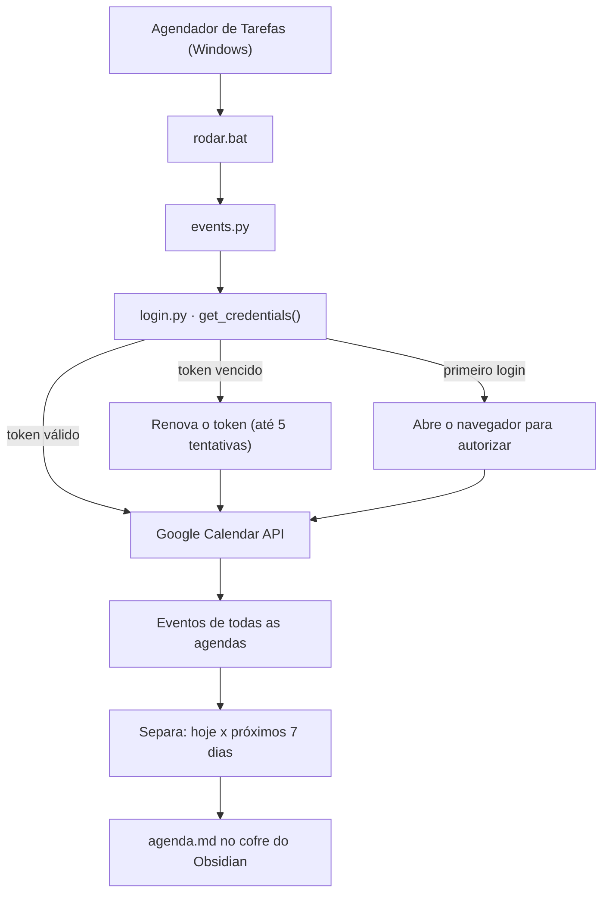

<div align="center">


# Calendar → Obsidian


_Sincroniza seus eventos do **Google Calendar** com o **Obsidian**_
<br>
o script gera uma nota em Markdown com a agenda de **hoje** e dos **próximos 7 dias**, com cada evento colorido de acordo com a agenda de origem. Roda sozinho pelo Agendador de Tarefas do Windows.


---

[O que faz](#o-que-ele-faz) | [Demonstração](#demonstração) | [Como funciona](#como-funciona) | [Estrutura do projeto](#estrutura-do-projeto) | [Tecnologias](#tecnologias) | [Instalação](#instalação) | [Personalização](#personalização) | [Observações](#observações)

---

</div>

<br>

## Problematização

Eu, como muitos, sou organizada **desde que eu me lembre e veja**. O problema não era planejamento, era **visibilidade**: o calendário morava em um app e minhas anotações e estudos em outro, e eu precisava lembrar de abrir o calendário.

Este projeto traz a agenda para dentro do lugar onde eu já escrevo e estudo todo dia. A nota aparece no Obsidian, atualizada, sem eu precisar fazer nada.

<br>

## O que ele faz

- Lê todas as suas agendas do Google (Pessoal, Trabalho, Faculdade etc.) com acesso somente leitura
- Gera uma nota `agenda.md` com duas seções:Eventos de hoje e Eventos da semana
- Mostra cada evento com um rótulo colorido pela cor da agenda no Google Calendar
- Trata eventos com horário e eventos de dia inteiro
- Renova o login sozinho
- Atualiza automaticamente pelo Agendador de Tarefas do Windows

<br>

## Demonstração


<br><br>

A nota gerada tem este formato (o Obsidian renderiza o HTML com as cores):

```markdown
#### Segunda-feira • 16/11
## Eventos de hoje ☀️
---
- <span style='color: #2b2b2b; border-radius:2px; padding: 0 6px; background-color:#7986cb'>Work</span> ─ **16/11 07:00**  <span style='color:#7986cb'>─</span> Trabalho
- <span style='color: #2b2b2b; border-radius:2px; padding: 0 6px; background-color:#33b679'>Academic</span> ─ **16/11**  <span style='color:#33b679'>─</span> Prova

## Eventos da semana 🪴
---
- <span style='color: #2b2b2b; border-radius:2px; padding: 0 6px; background-color:#33b679'>Academic</span> ─ **18/11**  <span style='color:#33b679'>─</span> Apresentação de trabalho
```

<br>

> [!TIP]
> Você pode personalizar os títulos, textos e layouts com preferir. Caso queria ver mais sobre, [clique aqui]().

<br>

## Como funciona



1. **`login.py`** cuida da autenticação (OAuth 2.0). Se o token ainda vale, devolve na hora. Se venceu, renova sozinho, esperando e tentando de novo se a rede falhar. Só abre o navegador no primeiro login ou se o acesso expirar de vez.
2. **`events.py`** lista as agendas da conta, busca os eventos de cada uma, ordena por data e monta o Markdown.
3. O arquivo `agenda.md` é gravado dentro do seu cofre do Obsidian.

> [!IMPORTANT]
> O fluxo é de **uma via**: o Google Calendar alimenta o Obsidian. Editar a nota **não** altera o calendário, e a cada execução o `agenda.md` é reescrito.


<br>

## Estrutura do projeto

```
calendar-obsidian/
├── events.py            # busca os eventos e gera o agenda.md
├── login.py             # autenticação OAuth, renovação e tentativas de rede
├── rodar.example.bat    # modelo do atalho para o Agendador de Tarefas
├── requirements.txt     # dependências
├── .gitignore
└── README.md

# Criados localmente 
├── credentials.json     # identidade do seu app no Google Cloud
├── token.json           # sua autorização guardada
└── log.txt              # registro das execuções automáticas
```

<br>

## Tecnologias

| Tecnologia | Para quê |
|---|---|
| [Python 3.11+](https://www.python.org/) | Linguagem do script |
| [Google Calendar API v3](https://developers.google.com/calendar/api) | Ler as agendas e os eventos |
| OAuth 2.0 (`google-auth-oauthlib`) | Login seguro, com permissão só de leitura |
| `google-api-python-client` | Cliente oficial da API do Google |
| [Obsidian](https://obsidian.md/) | Onde a nota é exibida (Markdown + HTML inline) |
| Agendador de Tarefas do Windows | Rodar o script automaticamente |

<br>

## Instalação

### Pré-requisitos

- Python **3.11 ou superior**
- Uma conta Google com agendas
- Um cofre (*vault*) do Obsidian
- Windows (para a parte de automação; o script em si é Python puro)

### 1. Clone o repositório

```bash
git clone https://github.com/SEU_USUARIO/calendar-obsidian.git
cd calendar-obsidian
```

### 2. Instale as dependências

```bash
pip install -r requirements.txt
```

Se preferir isolar o projeto, crie um ambiente virtual antes:

```bash
python -m venv .venv
.venv\Scripts\activate
pip install -r requirements.txt
```

### 3. Crie as credenciais no Google Cloud

> A interface do Google muda de vez em quando, então os nomes dos menus podem variar um pouco.

1. Acesse o [Google Cloud Console](https://console.cloud.google.com/) e **crie um projeto**.
2. Em **APIs e serviços → Biblioteca**, procure **Google Calendar API** e clique em **Ativar**.
3. Configure a **tela de consentimento OAuth**:
   - Tipo de usuário: **Externo**
   - Em **Usuários de teste**, adicione o seu próprio e-mail
   - Escopo: `.../auth/calendar.readonly` (somente leitura)
4. Em **Credenciais → Criar credenciais → ID do cliente OAuth**, escolha **Aplicativo para computador** (*Desktop app*).
5. Baixe o JSON, renomeie para **`credentials.json`** e coloque na pasta do projeto.

> [!WARNING]
> **Conta da faculdade ou do trabalho:** se você criar o projeto com uma conta de organização, pode aparecer o erro `403: org_internal`. Use uma conta Gmail pessoal ou mude o tipo de usuário para **Externo**.

> [!WARNING]
> **Modo Testing:** enquanto o app estiver em modo de teste, o Google pode expirar o login a cada ~7 dias. Para evitar, publique o app (Publicar app na tela de consentimento). Para uso pessoal, não é preciso passar pela verificação do Google.

### 4. Configure o caminho do seu cofre

Abra o `events.py` e ajuste a constante `VAULT`:

```python
VAULT = Path(r"C:\Users\SEU_USUARIO\Documents\Meu Cofre")
```

### 5. Faça o primeiro login

```bash
python login.py
```

O navegador abre pedindo autorização. Como o app é seu e não foi verificado pelo Google, aparece o aviso de **"app não verificado"**: clique em **Avançado → Acessar (nome do app)**. Isso cria o `token.json`.

### 6. Rode

```bash
python events.py
```

A nota `agenda.md` aparece no seu cofre!

## Automatizando no Windows

### 1. Crie o `rodar.bat`

Copie o `rodar.example.bat` para `rodar.bat` e ajuste os caminhos:

```bat
@echo off
cd /d "C:\caminho\do\projeto"
python events.py >> log.txt 2>&1
```

- O `cd /d` garante que o script ache o `token.json` mesmo rodando pelo Agendador.
- O `>> log.txt 2>&1` guarda tudo o que o script imprimir, inclusive erros. Como a tarefa roda escondida, o `log.txt` é a forma de descobrir o que deu errado.
- Se você usa ambiente virtual ou um Python específico, troque `python` pelo caminho completo do executável.

Teste com um duplo clique antes de agendar.

### 2. Crie a tarefa

1. Abra o **Agendador de Tarefas** → **Criar Tarefa Básica**.
2. **Disparador:** *Quando eu fizer logon* (e, se quiser, um diário também).
3. **Ação:** *Iniciar um programa* → escolha o `rodar.bat`.

### 3. Ajustes recomendados

| Onde | Configuração |
|---|---|
| Condições | Marcar *Iniciar somente se a seguinte conexão de rede estiver disponível* |
| Condições | Desmarcar *Iniciar somente se o computador estiver ligado na energia CA* |
| Configurações | *Executar assim que possível após uma inicialização agendada ser perdida* |
| Configurações | *Se ocorrer falha na tarefa, reiniciar a cada 1 minuto, até 3 vezes* |
| Configurações | *Interromper a tarefa se executada por mais de 1 hora* |
| Disparadores | Atrasar a tarefa em 1 ou 2 minutos após o logon (dá tempo de o Wi-Fi conectar) |

> No macOS/Linux, o script em si funciona igual; para agendar, use `cron` ou `launchd` (não testado neste projeto).

<br>

## Personalização

Tudo o que dá para ajustar está no `events.py`.

**Quantos dias mostrar na semana** (em `main`):

```python
end_week = end_today + dt.timedelta(days=7)   # troque o 7
```

**Nome e local da nota** (em `main`):

```python
(VAULT / "agenda.md").write_text(...)
# ex.: (VAULT / "Agenda" / "agenda.md")  → a pasta precisa existir
```

**Títulos, textos e emojis das seções** (em `main`):

```python
lines += build_section("## Eventos de hoje ☀️", today)
lines += [""] + build_section("## Eventos da semana 🪴", week)
```

**Visual do rótulo colorido** (em `get_events`): a cor de fundo vem da cor da agenda no Google Calendar, então basta mudar a cor lá. Já o resto do estilo está no `style='...'` da variável `line`: cor do texto (`#2b2b2b`), `padding` e `border-radius`. Se quiser usar a cor de texto que o próprio Google escolheu para combinar com cada agenda, use `agenda["foregroundColor"]`.

**Formato de data e hora:**

```python
hour_text = when.strftime("%d/%m %H:%M")   # ex.: 16/11 07:00
```

**Ignorar uma agenda** (por exemplo, os feriados), no início do `for agenda in agendas` em `get_events`:

```python
IGNORAR = {"Holidays in Brazil"}

for agenda in agendas:
    if agenda["summary"] in IGNORAR:
        continue
    ...
```

<br>

## Observações 

### Segurança e privacidade

- O app pede apenas o escopo **`calendar.readonly`**: ele nunca consegue criar, editar ou apagar eventos.
- **Nunca** envie o `credentials.json` nem o `token.json` para o GitHub. Eles já estão no `.gitignore`.
- Seus eventos são lidos direto do Google para o seu computador; nada passa por servidor de terceiros.

### Limitações conhecidas

- O fluxo é **de uma via** e o `agenda.md` é **sobrescrito** a cada execução: não escreva suas anotações dentro dele.
- O script só roda com o **computador ligado**.
- Eventos de dia inteiro que duram vários dias aparecem apenas na data de início.

### Solução de problemas

| Sintoma | Provável causa |
|---|---|
| `Error 403: org_internal` ao fazer login | O app foi criado como *Interno* (conta de organização). Use Gmail pessoal ou mude para *Externo*. |
| `getaddrinfo failed` / `TransportError` ao ligar o notebook | A rede ainda não subiu. O script já tenta 5 vezes; adicione um atraso na tarefa. |
| A nota para de atualizar depois de uns 7 dias | App em modo *Testing*. Rode `python login.py` de novo ou publique o app. |
| `O sistema não pode encontrar o caminho especificado` no `.bat` | Caminho da pasta ou do Python errado no `rodar.bat`. |
| `FileNotFoundError: token.json` no Agendador | Falta o `cd /d` no `.bat`: o script está rodando de outra pasta. |
| `ModuleNotFoundError: google...` | O Python usado não é o mesmo onde você instalou as dependências. |
| A nota fica vazia | Confira se está logada na conta certa e se há eventos no período (o script já percorre todas as agendas). |
| As cores não aparecem | Clique em outra linha ou use o Modo de leitura. A linha em edição mostra o código-fonte. |
