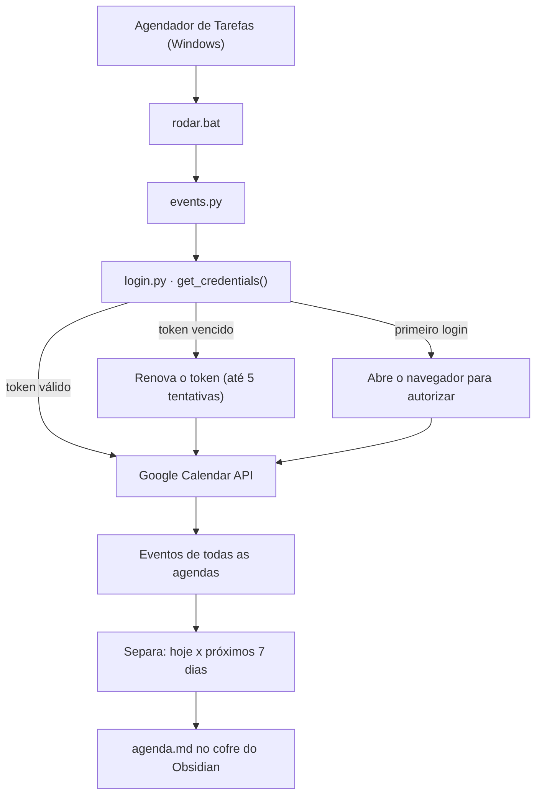

<div align="center">


# Calendar → Obsidian


_Sincroniza seus eventos do **Google Calendar** com o **Obsidian**_
<br>
o script gera uma nota em Markdown com a agenda de **hoje** e dos **próximos 7 dias**, com cada evento colorido de acordo com a agenda de origem. Roda sozinho pelo Agendador de Tarefas do Windows.


---

[O que faz](#o-que-ele-faz) | [Demonstração](#demonstração) | [Como funciona](#como-funciona) | [Estrutura do projeto](#estrutura-do-projeto) | [Tecnologias](#tecnologias) | [Instalação](https://github.com/abeatrizoliveira/google_calendar_obsidian/blob/main/docs/installation.md) | [Personalização](https://github.com/abeatrizoliveira/google_calendar_obsidian/blob/main/docs/customization.md) | [Observações](https://github.com/abeatrizoliveira/google_calendar_obsidian/blob/main/docs/observation.md)

---

</div>

<br>

## Problematização

Eu, como muitos, sou organizada **desde que eu me lembre e veja**. O problema não era planejamento, era **visibilidade**: o calendário morava em um app e minhas anotações e estudos em outro, e eu precisava lembrar de abrir o calendário.

Este projeto traz a agenda para dentro do lugar onde eu já escrevo e estudo todo dia. A nota aparece no Obsidian, atualizada, sem eu precisar fazer nada.

<br>

## O que ele faz

- Lê todas as suas agendas do Google (Pessoal, Trabalho, Faculdade etc.) com acesso somente leitura
- Gera uma nota `agenda.md` com duas seções:Eventos de hoje e Eventos da semana
- Mostra cada evento com um rótulo colorido pela cor da agenda no Google Calendar
- Trata eventos com horário e eventos de dia inteiro
- Renova o login sozinho
- Atualiza automaticamente pelo Agendador de Tarefas do Windows

<br>

## Demonstração


<br><br>

A nota gerada tem este formato (o Obsidian renderiza o HTML com as cores):

```markdown
#### Segunda-feira • 16/11
## Eventos de hoje ☀️
---
- <span style='color: #2b2b2b; border-radius:2px; padding: 0 6px; background-color:#7986cb'>Work</span> ─ **16/11 07:00**  <span style='color:#7986cb'>─</span> Trabalho
- <span style='color: #2b2b2b; border-radius:2px; padding: 0 6px; background-color:#33b679'>Academic</span> ─ **16/11**  <span style='color:#33b679'>─</span> Prova

## Eventos da semana 🪴
---
- <span style='color: #2b2b2b; border-radius:2px; padding: 0 6px; background-color:#33b679'>Academic</span> ─ **18/11**  <span style='color:#33b679'>─</span> Apresentação de trabalho
```

<br>

> [!TIP]
> Você pode personalizar os títulos, textos e layouts com preferir. Caso queria ver mais sobre, [clique aqui](#personalização).

<br>

## Como funciona



<br>

## Estrutura do projeto

```
calendar-obsidian/
├── events.py            # busca os eventos e gera o agenda.md
├── login.py             # autenticação OAuth, renovação e tentativas de rede
├── rodar.example.bat    # modelo do atalho para o Agendador de Tarefas
├── requirements.txt     # dependências
├── .gitignore
└── README.md

# Criados localmente 
├── credentials.json     # identidade do seu app no Google Cloud
├── token.json           # sua autorização guardada
└── log.txt              # registro das execuções automáticas
```

<br>

## Tecnologias

| Tecnologia | Para quê |
|---|---|
| [Python 3.11+](https://www.python.org/) | Linguagem do script |
| [Google Calendar API v3](https://developers.google.com/calendar/api) | Ler as agendas e os eventos |
| OAuth 2.0 (`google-auth-oauthlib`) | Login seguro, com permissão só de leitura |
| `google-api-python-client` | Cliente oficial da API do Google |
| [Obsidian](https://obsidian.md/) | Onde a nota é exibida (Markdown + HTML inline) |
| Agendador de Tarefas do Windows | Rodar o script automaticamente |

<br>

---

> Encontre a instalação e a configuração [aqui](https://github.com/abeatrizoliveira/google_calendar_obsidian/blob/main/docs/installation.md)

> Encontre comentários sobre privacidade e soluções de problemas [aqui](https://github.com/abeatrizoliveira/google_calendar_obsidian/blob/main/docs/observation.md)

> Encontre formas de personalizar [aqui](https://github.com/abeatrizoliveira/google_calendar_obsidian/blob/main/docs/customization.md)

---

<div align="center">
Desenvolvido por Beatriz :) 
    <br>
    2026 
</div>
